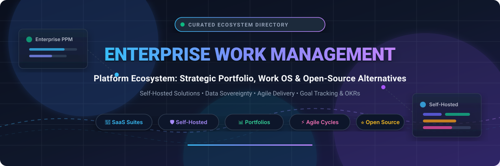

<div align="center">



# 🏢 Awesome Enterprise Work Management Platform 🚀

**A curated, comprehensive ecosystem directory of top Enterprise Work Management (EWM), Collaborative Work Management (CWM), and Project Portfolio Management (PPM) suites — featuring leading enterprise SaaS solutions and open-source self-hosted alternatives.**

<p align="center">
  <a href="https://github.com/ishandutta2007/Awesome-Awesome-Awesome"></a><a href="https://discord.gg/jc4xtF58Ve"></a>
  <a href="https://github.com/ishandutta2007/Awesome-Enterprise-Work-Management-Platform/stargazers"></a>
  <a href="https://github.com/ishandutta2007/Awesome-Enterprise-Work-Management-Platform/network/members"></a>
  <a href="https://github.com/ishandutta2007/Awesome-Enterprise-Work-Management-Platform/pulls"></a>
  <a href="https://github.com/ishandutta2007/Awesome-Enterprise-Work-Management-Platform/blob/main/LICENSE"></a>
  <a href="https://github.com/ishandutta2007"></a>
</p>

*Empowering operations leaders, PMOs, engineering managers, and distributed enterprises to choose the ideal work execution platform.*

</div>

---

## 📑 Table of Contents

- [🔍 Sector Overview & Market Dynamics](#-sector-overview--market-dynamics)
- [🏢 Enterprise SaaS & Hosted Platforms](#-enterprise-saas--hosted-platforms)
  - [📊 SaaS Platforms Comparison Table](#-saas-platforms-comparison-table)
  - [🔎 In-Depth SaaS Profiles](#-in-depth-saas-profiles)
- [🛡️ Open-Source & Self-Hosted Solutions](#️-open-source--self-hosted-solutions)
  - [⭐ Open-Source Leaderboard (Sorted by Stars)](#-open-source-leaderboard-sorted-by-stars)
  - [📦 Deep Dive: Open-Source Platforms](#-deep-dive-open-source-platforms)
- [💡 Enterprise Evaluation & Selection Framework](#-enterprise-evaluation--selection-framework)
- [🤝 How to Contribute](#-how-to-contribute)
- [⚖️ Disclaimer](#️-disclaimer)
- [⭐ Star History](#-star-history)
- [💖 Support & Sponsoring](#-support--sponsoring)

---

## 🔍 Sector Overview & Market Dynamics

The global **Enterprise Work Management (EWM)** and **Collaborative Work Management (CWM)** market reached an estimated valuation of **$5.8 Billion in 2024** and is projected to expand to **$13.5 Billion by 2030**, reflecting a vigorous compound annual growth rate (**CAGR of ~13.8%**).

### 📈 Market Concentration & Fragmentation Analysis

- **Moderately Fragmented Ecosystem**: Unlike operating systems or hyperscale cloud infrastructure, the enterprise work management sector is **moderately fragmented** rather than winner-take-all. Organizations rarely use a single tool across all departments; product and software teams gravitate toward issue-centric systems (Jira, Plane, Huly), marketing and creative agencies require visual approval proofing (Workfront, Wrike), while business operations leverage flexible Work OS grids (monday.com, Smartsheet).
- **Megavendor Governance vs. Specialized Agility**: Enterprise suites anchored by Microsoft and Adobe dominate strategic portfolio governance, while fast-growing Work OS platforms compete fiercely for multi-seat departmental adoption.
- **The Self-Hosted & Data Sovereignty Surge**: With increasing regulatory enforcement (GDPR, HIPAA, SOC 2 Type II) and strict AI data privacy governance, enterprise adoption of **self-hosted, open-source work management software** (such as OpenProject, Plane, Huly, AppFlowy, and NocoDB) is accelerating rapidly to ensure complete ownership of proprietary project roadmaps and intellectual property.

---

## 🏢 Enterprise SaaS & Hosted Platforms

Enterprise SaaS work management suites deliver battle-tested cloud scalability, identity management (SSO/SAML/SCIM), enterprise security, compliance certifications, and deep multi-app ecosystem integrations.

### 📊 SaaS Platforms Comparison Table

> The table below is sorted in **descending order by company size** (market capitalization or latest enterprise valuation).

| 🏢 Platform / Solution | 💰 Company Size (Valuation / Revenue) | 🏷️ Starting Pricing (Specific Tier) | 🎁 Free Forever / Trial Limits | 🎯 Key Capabilities & Best For |
| :--- | :--- | :--- | :--- | :--- |
| **[Microsoft Project & Planner](https://www.microsoft.com/en-us/microsoft-365/project)** | **~$3.10 Trillion Market Cap**<br>• FY24 Revenue: $245.1B *(NASDAQ: MSFT)* | **$10.00 / user / month**<br>*(Planner & Project Plan 1, annual commitment; Plan 3 at $30/mo)* | **30-Day Free Trial**<br>• Up to 25 user licenses<br>• Full Plan 3 features (Gantt, scheduling, resource planning) | **Enterprise PPM standard**: Deep native integration with Microsoft 365, Teams, Azure DevOps, and Power BI dashboards. Best for Microsoft-centric organizations needing rigorous capital planning and scheduling. |
| **[Adobe Workfront](https://business.adobe.com/products/workfront/main.html)** | **~$220 Billion Market Cap**<br>• FY24 Revenue: $21.4B *(NASDAQ: ADBE)* | **~$30.00 – $40.00 / user / month**<br>*(Select tier annual contract; min annual commitment ~$15,000–$30,000)* | **14 to 30-Day Guided Proof-of-Concept**<br>• Enterprise sandbox demo upon sales request<br>• No permanent free tier | **Creative & Marketing Work OS**: Sophisticated portfolio governance, digital asset proofing, time tracking, and bi-directional Adobe Creative Cloud integration. Best for large creative, marketing, and agency enterprises. |
| **[Jira Work Management](https://www.atlassian.com/software/jira/work-management)** | **~$48 Billion Market Cap**<br>• FY24 Revenue: $4.4B *(NASDAQ: TEAM)* | **$7.75 / user / month**<br>*(Standard plan, billed annually or $8.15 monthly; Premium at $15.25/mo)* | **Free Forever Tier**<br>• Up to 10 users<br>• 2 GB file storage<br>• Unlimited boards & timelines<br>• 14-day trial for Standard/Premium | **Cross-functional Agility**: Bridges business teams with engineering. Pre-built templates for marketing, legal, HR, and procurement sharing workflows with Jira Software, Confluence, and Loom. |
| **[monday.com Enterprise](https://monday.com/)** | **~$13.5 Billion Market Cap**<br>• FY24 Revenue: $972M *(NASDAQ: MNDY)* | **$9.00 / seat / month**<br>*(Basic plan billed annually, min 3 seats = $27/mo; Standard $12/mo; Pro $19/mo)* | **Free Forever Tier**<br>• Up to 2 team members<br>• Up to 3 boards<br>• 500 MB cloud storage<br>• 14-day free trial of Pro (no credit card) | **Visual Work OS**: Highly customizable modular boards, dynamic widgets, 200+ pre-built automations, and executive portfolio dashboards. Best for teams wanting visual flexibility without technical coding. |
| **[Smartsheet](https://www.smartsheet.com/)** | **$8.4 Billion Valuation**<br>• Acquired 2024 by Blackstone & Vista<br>• FY24 Revenue: $1.04B | **$7.00 / user / month**<br>*(Pro plan billed annually, up to 10 users; Business is $25/mo, min 3 users)* | **Free Forever Tier**<br>• 1 user & up to 2 sheets<br>• 500 MB storage limit<br>• 30-day free trial of full Business plan | **Spreadsheet-Familiar Work Execution**: Combines tabular ease with Gantt charts, approval workflows, dynamic forms, and automated alerts. Best for operations transitioning from complex Excel spreadsheets. |
| **[ClickUp](https://clickup.com/)** | **$4.0 Billion Valuation**<br>• Series C Private Valuation<br>• ~$200M+ Annual ARR | **$7.00 / user / month**<br>*(Unlimited plan billed annually or $10 monthly; Business at $12/mo)* | **Free Forever Tier**<br>• Unlimited tasks & members<br>• 100 MB cloud storage<br>• 14-day free trial of Business/Enterprise | **All-in-One Productivity Platform**: Nested hierarchies, integrated docs, whiteboards, time tracking, sprint cycles, dashboards, and ClickUp AI. Best for teams wanting maximum feature breadth in a single tool. |
| **[Asana Enterprise](https://asana.com/)** | **~$3.2 Billion Market Cap**<br>• FY24 Revenue: $652M *(NYSE: ASAN)* | **$10.99 / user / month**<br>*(Starter plan billed annually or $13.49 monthly; Advanced at $24.99/mo)* | **Free Personal Plan**<br>• Up to 10 teammates<br>• Unlimited tasks & projects<br>• 100 MB/file attachment limit<br>• 30-day trial of Starter/Advanced | **Coordination & Strategic OKRs**: Industry standard for goal tracking, portfolio management, workload capacity balancing, and automated cross-departmental project routing. Approachable and polished. |
| **[Wrike](https://www.wrike.com/)** | **~$2.25 Billion Valuation**<br>• Symphony Technology Group (STG)<br>• ~$200M+ Annual ARR | **$9.80 / user / month**<br>*(Team plan billed annually, min 2 users; Business is $24.80/mo)* | **Free Forever Tier**<br>• Unlimited users<br>• 2 GB cloud storage<br>• Basic task management<br>• 14-day free trial of Team/Business | **Collaborative Work Blueprinting**: Dynamic request forms, interactive Gantt charts, customized work statuses, proofing/approvals, and enterprise workload planning for professional services. |
| **[Planview](https://www.planview.com/)** | **~$1.8 Billion Valuation**<br>• Backed by TPG & TA Associates<br>• ~$450M Annual Revenue | **$29.00 / user / month**<br>*(Planview ProjectPlace; Portfolios/AdaptiveWork starts at ~$40–$65/mo)* | **30-Day Free Trial**<br>• Available for Planview ProjectPlace<br>• Up to 10 users<br>• No permanent free tier | **Strategic Portfolio Management (SPM)**: Heavyweight governance for enterprise IT, capital project allocation, capacity planning, demand forecasting, and enterprise architecture synchronization. |

---

### 🔎 In-Depth SaaS Profiles

#### 1. 🔷 [Microsoft Project & Planner](https://www.microsoft.com/en-us/microsoft-365/project)
- **Architecture**: Cloud-hosted SaaS integrated natively within Microsoft 365, Microsoft Teams, SharePoint, and Microsoft Power Platform.
- **Enterprise Features**: Critical path analysis, advanced resource leveling, baseline tracking, and Power BI report authoring.
- **Best Suited For**: Large corporations and government entities with existing enterprise agreements requiring centralized PMO governance.

#### 2. 🎨 [Adobe Workfront](https://business.adobe.com/products/workfront/main.html)
- **Architecture**: Enterprise cloud platform integrated into Adobe Experience Cloud and Creative Cloud applications (Photoshop, InDesign, Premiere Pro).
- **Enterprise Features**: Multi-tiered approval chains, digital markup proofing, resource allocation matrices, and audit logging.
- **Best Suited For**: Global creative departments, ad agencies, and enterprise marketing divisions coordinating complex campaign lifecycles.

#### 3. 🎯 [Jira Work Management](https://www.atlassian.com/software/jira/work-management)
- **Architecture**: Atlassian Cloud infrastructure seamlessly linked with Jira Software, Confluence, Bitbucket, and Atlas.
- **Enterprise Features**: Cross-project dependency mapping, automated triggers, Atlassian Guard access management, and Jira Query Language (JQL).
- **Best Suited For**: Organizations already committed to Atlassian tools seeking unified tracking between technical developers and operational business teams.

#### 4. 🎛️ [monday.com Enterprise](https://monday.com/)
- **Architecture**: Cloud Work OS built on real-time responsive web grids, microservices, and mobile clients.
- **Enterprise Features**: Multi-level permissions, HIPAA/SOC 2 compliance, audit logs, 250,000 automation actions/month on Enterprise, and board views (Kanban, Gantt, Chart, Map).
- **Best Suited For**: Agile businesses seeking rapid departmental onboarding, visually intuitive status trackers, and no-code operational workflows.

#### 5. 📑 [Smartsheet](https://www.smartsheet.com/)
- **Architecture**: Cloud-native spreadsheet-relational hybrid platform with granular permission models.
- **Enterprise Features**: Smartsheet Control Center for automated project provisioning, Dynamic View for selective data visibility, and Data Shuttle.
- **Best Suited For**: Finance, construction, and logistics teams accustomed to Microsoft Excel who require automated workflows and multi-project reporting.

#### 6. ⚡ [ClickUp](https://clickup.com/)
- **Architecture**: Multi-tenant cloud suite featuring an all-inclusive hierarchy: Workspaces → Spaces → Folders → Lists → Tasks → Subtasks.
- **Enterprise Features**: 15+ interactive views, native whiteboard diagramming, real-time collaborative docs, embedded spreadsheets, and sprint points.
- **Best Suited For**: Startups and mid-market organizations seeking all-in-one consolidation to replace multiple disparate software subscriptions.

#### 7. 📈 [Asana Enterprise](https://asana.com/)
- **Architecture**: Work Graph data model mapping relationships between units of work, responsible individuals, and overarching business objectives.
- **Enterprise Features**: Workload capacity planning, enterprise workflow builder, universal reporting, SAML 2.0 SSO, and Service Accounts.
- **Best Suited For**: Knowledge-worker enterprises requiring clean user adoption, seamless cross-functional handoffs, and executive OKR alignment.

#### 8. 🛠️ [Wrike](https://www.wrike.com/)
- **Architecture**: Flexible collaborative work management engine with custom item types and branching intake workflows.
- **Enterprise Features**: Interactive Gantt scheduling, custom user roles, AI work assistant for risk predictions, and enterprise-grade encryption key management (Wrike Lock).
- **Best Suited For**: Professional services organizations, creative studios, and PMOs demanding structured client intake workflows and billable hour tracking.

#### 9. 🏛️ [Planview](https://www.planview.com/)
- **Architecture**: Comprehensive Strategic Portfolio Management (SPM) and Value Stream Management (VSM) enterprise platform.
- **Enterprise Features**: Multi-year scenario modeling, investment versus capacity analysis, OKR alignment, and Agile release train coordination.
- **Best Suited For**: Fortune 500 enterprises, PMO executives, and enterprise architects making multi-million dollar capital expenditure decisions.

---

## 🛡️ Open-Source & Self-Hosted Solutions

Open-source and self-hosted work management platforms grant organizations **total data sovereignty**, freedom from per-seat license inflation, complete control over AI data telemetry, and seamless air-gapped on-premise deployment.

### ⭐ Open-Source Leaderboard (Sorted by Stars)

The following open-source platforms are ranked in **descending order by GitHub Stars_Count**:

| 🏆 Rank | 📦 Project | ⭐ Stars_Badge (Click to Stargazers) | 📜 License | 🛠️ Core Tech Stack | 💡 Focus / Deployment |
| :---: | :--- | :---: | :---: | :--- | :--- |
| **#1** | **[AppFlowy](https://github.com/AppFlowy-IO/AppFlowy)** | [](https://github.com/AppFlowy-IO/AppFlowy/stargazers) | AGPL-3.0 | Flutter, Rust, SQLite/PostgreSQL | Collaborative AI workspace, Notion alternative, boards & docs |
| **#2** | **[NocoDB](https://github.com/nocodb/nocodb)** | [](https://github.com/nocodb/nocodb/stargazers) | AGPL-3.0 | Node.js, Vue.js, Any SQL DB | Smart spreadsheet & Airtable/Smartsheet alternative, database Work OS |
| **#3** | **[Plane](https://github.com/makeplane/plane)** | [](https://github.com/makeplane/plane/stargazers) | AGPL-3.0 | Python, Django, Next.js, Docker | Modern Jira & Linear alternative with cycles, modules, pages, triage |
| **#4** | **[Huly Platform](https://github.com/hcengineering/platform)** | [](https://github.com/hcengineering/platform/stargazers) | EPL-2.0 | TypeScript, React, Node.js, Docker | All-in-one project management platform, Linear/Slack/Notion alternative |
| **#5** | **[Focalboard](https://github.com/mattermost-community/focalboard)** | [](https://github.com/mattermost-community/focalboard/stargazers) | MIT / AGPL | Go, React, TypeScript, SQLite/PostgreSQL | Self-hosted Trello & Asana alternative integrated into Mattermost |
| **#6** | **[Super Productivity](https://github.com/super-productivity/super-productivity)** | [](https://github.com/super-productivity/super-productivity/stargazers) | MIT | TypeScript, Angular, Electron | Timeboxing, task management, and Jira/GitLab/GitHub synchronization |
| **#7** | **[Wekan](https://github.com/wekan/wekan)** | [](https://github.com/wekan/wekan/stargazers) | MIT | Meteor, Node.js, MongoDB | Mature open-source Kanban board, offline capable, zero telemetry |
| **#8** | **[OpenProject](https://github.com/opf/openproject)** | [](https://github.com/opf/openproject/stargazers) | GPLv3 | Ruby on Rails, Angular, PostgreSQL | Enterprise PPM, interactive Gantt charts, roadmaps, agile boards |
| **#9** | **[Planka](https://github.com/plankanban/planka)** | [](https://github.com/plankanban/planka/stargazers) | AGPL-3.0 | React, Redux, Node.js, PostgreSQL | Lightweight, responsive real-time Kanban tracking for agile teams |
| **#10** | **[Leantime](https://github.com/Leantime/leantime)** | [](https://github.com/Leantime/leantime/stargazers) | AGPL-3.0 | PHP, Vue.js, MySQL | Goals-focused project management tailored for ADHD & cognitive diversity |
| **#11** | **[Kanboard](https://github.com/kanboard/kanboard)** | [](https://github.com/kanboard/kanboard/stargazers) | MIT | PHP, SQLite/PostgreSQL/MySQL | Minimalist, ultra-fast visual task board with automated actions |
| **#12** | **[Kaneo](https://github.com/usekaneo/kaneo)** | [](https://github.com/usekaneo/kaneo/stargazers) | MIT | TypeScript, Next.js, PostgreSQL | Modern open-source project management that works for you, not against you |
| **#13** | **[Baserow](https://github.com/baserow/baserow)** | [](https://github.com/baserow/baserow/stargazers) | MIT / Commercial | Python, Django, Vue.js, PostgreSQL | Open-source no-code relational database & custom project management |
| **#14** | **[Redmine](https://github.com/redmine/redmine)** | [](https://github.com/redmine/redmine/stargazers) | GPLv2 | Ruby on Rails, MySQL/PostgreSQL | Proven open-source issue tracker with rich plugin ecosystem and wikis |
| **#15** | **[Vikunja](https://github.com/go-vikunja/vikunja)** | [](https://github.com/go-vikunja/vikunja/stargazers) | AGPL-3.0 | Go, TypeScript, Vue.js | End-to-end to-do & work manager with Gantt, table, and Kanban views |
| **#16** | **[Taskcafe](https://github.com/JordanKnott/taskcafe)** | [](https://github.com/JordanKnott/taskcafe/stargazers) | MIT | Go, React, TypeScript, PostgreSQL | Open-source project management tool with Kanban boards & task lists |
| **#17** | **[Worklenz](https://github.com/Worklenz/worklenz)** | [](https://github.com/Worklenz/worklenz/stargazers) | AGPL-3.0 | Node.js, Angular, PostgreSQL | All-in-one team and project management with time tracking & roadmaps |
| **#18** | **[Taiga](https://github.com/taigaio/taiga-docker)** | [](https://github.com/taigaio/taiga-docker/stargazers) | MPL-2.0 / AGPL-3.0 | Python, Django, AngularJS, PostgreSQL | Dedicated Scrum & Kanban agile project management platform |
| **#19** | **[Restyaboard](https://github.com/RestyaPlatform/board)** | [](https://github.com/RestyaPlatform/board/stargazers) | OSL-3.0 | PHP, Backbone.js, PostgreSQL | Trello-like visual board with enterprise access control and chat |
| **#20** | **[Operately](https://github.com/operately/operately)** | [](https://github.com/operately/operately/stargazers) | Apache-2.0 | Elixir, Phoenix, React, PostgreSQL | Open-source company operating system, OKRs, milestones, cadence |
| **#21** | **[Lalabase](https://github.com/lalabase/lalabase)** | [](https://github.com/lalabase/lalabase/stargazers) | AGPL-3.0 | Go, Svelte, SQLite | Project brain for dev agencies: tickets, time billing, AI citations |
| **#22** | **[WorkBase](https://github.com/vocso-com/workbase)** | [](https://github.com/vocso-com/workbase/stargazers) | AGPL-3.0 | Electron, Node.js, Local SQLite | Offline-first desktop project manager with nested flow progress rollups |
| **#23** | **[Hopya](https://github.com/wnzn/hopya)** | [](https://github.com/wnzn/hopya/stargazers) | MIT | Node.js, TypeScript, PostgreSQL | Self-hosted work management with workspaces, docs, tables, automations |

---

### 📦 Deep Dive: Open-Source Platforms

#### 1. 🚀 [AppFlowy](https://github.com/AppFlowy-IO/AppFlowy) [](https://github.com/AppFlowy-IO/AppFlowy/stargazers)
- **Overview**: The leading open-source Notion alternative. AppFlowy brings projects, wikis, documents, and teams together with native AI capabilities while ensuring data sovereignty.
- **Tech Stack**: Built with Flutter frontend and high-performance Rust core, backing into SQLite for local mode or PostgreSQL for multi-user sync.
- **Key Capabilities**: Kanban boards, grid tables, document pages with slash commands, offline-first execution, and end-to-end encrypted team collaboration.
- **Honest Caveat**: Focuses on collaborative workspace and doc-centric project management rather than multi-tier Gantt portfolio scheduling.
- **Best For**: Creative, engineering, and knowledge teams seeking a customizable, privacy-first Notion replacement.

#### 2. 🗄️ [NocoDB](https://github.com/nocodb/nocodb) [](https://github.com/nocodb/nocodb/stargazers)
- **Overview**: The open-source smart spreadsheet and relational database Work OS that transforms any relational database into an Airtable/Smartsheet alternative.
- **Tech Stack**: Node.js, Vue.js; connects directly to MySQL, PostgreSQL, Microsoft SQL Server, SQLite, and MariaDB.
- **Key Capabilities**: Grid, Gallery, Kanban, Form, and Calendar views; automated webhooks, REST/GraphQL APIs, role-based access control, and formula columns.
- **Honest Caveat**: Requires database schema familiarity for complex multi-table relational designs.
- **Best For**: Organizations wanting a self-hosted Airtable or Smartsheet alternative connected directly to their private enterprise SQL database.

#### 3. ✈️ [Plane](https://github.com/makeplane/plane) [](https://github.com/makeplane/plane/stargazers)
- **Overview**: Modern, beautifully designed open-source alternative to Jira, Linear, and ClickUp. Provides end-to-end project tracking from ideation to release.
- **Tech Stack**: Python/Django backend, Next.js/React frontend, Redis, Celery, PostgreSQL, Docker/Kubernetes deployable.
- **Key Capabilities**: Issues with rich sub-properties, Cycles (sprints with burndown charts), Modules (epics/sub-projects), Pages (AI-assisted documentation), and Analytics views.
- **Honest Caveat**: Rapid release cycle; enterprise governance, SSO integrations, and legacy plugin ecosystems are still actively maturing.
- **Best For**: High-growth engineering teams, product startups, and tech-forward organizations desiring a fast, modern Jira alternative.

#### 4. ⚡ [Huly Platform](https://github.com/hcengineering/platform) [](https://github.com/hcengineering/platform/stargazers)
- **Overview**: All-in-one open-source project management platform that combines task tracking, team communication, and documentation as an alternative to Linear, Jira, Slack, and Notion.
- **Tech Stack**: TypeScript, React, Node.js, ElasticSearch, Docker Compose.
- **Key Capabilities**: Real-time collaborative workspace, issue tracker, integrated chat, audio channels, knowledge base, and GitHub two-way synchronization.
- **Honest Caveat**: Rich all-in-one ecosystem requires adequate memory and CPU resources for self-hosting.
- **Best For**: Tech startups and software companies looking for a single unified workspace to replace both Jira and Slack.

#### 5. 📋 [Focalboard](https://github.com/mattermost-community/focalboard) [](https://github.com/mattermost-community/focalboard/stargazers)
- **Overview**: Open-source, multilingual, self-hosted project and work management platform developed by Mattermost as an alternative to Trello, Notion, and Asana.
- **Tech Stack**: Go backend, React/TypeScript frontend, SQLite or PostgreSQL.
- **Key Capabilities**: Boards, tables, galleries, and calendar views; integrated tightly into Mattermost team channels or deployable as a standalone personal desktop app.
- **Honest Caveat**: Community-maintained mode; deep portfolio rollups and complex dependency Gantt charts are limited.
- **Best For**: Mattermost users, developers, and teams needing clean, channel-linked task and card management.

#### 6. ⏱️ [Super Productivity](https://github.com/super-productivity/super-productivity) [](https://github.com/super-productivity/super-productivity/stargazers)
- **Overview**: Advanced productivity and timeboxing application with built-in time tracking, Pomodoro timer, and deep synchronization across enterprise issue trackers.
- **Tech Stack**: TypeScript, Angular, Electron desktop (cross-platform Linux, Windows, macOS, Android).
- **Key Capabilities**: Two-way synchronization with Jira, GitHub, GitLab, and OpenProject; local data persistence with optional cloud sync (WebDAV, Dropbox, Google Drive); zero telemetry.
- **Honest Caveat**: Designed primarily for individuals and self-managing engineering contributors rather than multi-tiered executive PMOs.
- **Best For**: Software engineers and technical project leads managing personal daily execution against enterprise Jira/GitLab tasks.

#### 7. 🗂️ [Wekan](https://github.com/wekan/wekan) [](https://github.com/wekan/wekan/stargazers)
- **Overview**: The veteran, completely libre open-source collaborative Kanban board platform. Used globally by governments, universities, and security-critical enterprises.
- **Tech Stack**: Meteor, Node.js, MongoDB; easy deployment via Docker, Snap, Sandstorm, or source.
- **Key Capabilities**: Multi-board views, swimlanes, subtasks, checklists, granular permissions, rule-based automations, LDAP/OIDC integration, and zero telemetry.
- **Honest Caveat**: Relies on Meteor and MongoDB stack; the user interface is functional and classic rather than modern slick design.
- **Best For**: Air-gapped government environments, compliance-heavy institutions, and teams needing a robust, time-tested Trello alternative.

#### 8. 🌐 [OpenProject](https://github.com/opf/openproject) [](https://github.com/opf/openproject/stargazers)
- **Overview**: The gold standard for enterprise-grade open-source project portfolio management (PPM). Trusted worldwide for complete data sovereignty and rigorous project governance.
- **Tech Stack**: Ruby on Rails, Angular, PostgreSQL, packaged with official Docker containers and Linux packages.
- **Key Capabilities**: Interactive Gantt charts, multi-project portfolio planning, Agile boards (Scrum, Kanban, SAFe), budgeting, time recording, wikis, and integrations with Nextcloud, GitHub, and GitLab.
- **Honest Caveat**: Dual-license structure: Community Edition is GPLv3, but advanced enterprise add-ons (SAML/OIDC SSO, custom fields, two-factor auth enforcement) require paid Enterprise licenses.
- **Best For**: Enterprises, public sector departments, and engineering organizations seeking a full-featured, open-source replacement for MS Project and Jira.

#### 9. 📌 [Planka](https://github.com/plankanban/planka) [](https://github.com/plankanban/planka/stargazers)
- **Overview**: Elegant, lightning-fast open-source real-time Kanban board designed for modern engineering and operations teams.
- **Tech Stack**: React, Redux, Node.js, PostgreSQL; single-command Docker Compose deployment.
- **Key Capabilities**: Real-time multi-user card collaboration, attachments, markdown cards, user mentions, timer tracking, and OpenID Connect (OIDC) SSO support.
- **Honest Caveat**: Laser-focused on Kanban; does not natively offer Gantt timelines or complex portfolio dependency rollups.
- **Best For**: Small to medium agile teams wanting a beautiful, lightweight, self-hosted Trello alternative without bloat.

#### 10. 🧠 [Leantime](https://github.com/Leantime/leantime) [](https://github.com/Leantime/leantime/stargazers)
- **Overview**: Strategic project management system designed specifically for non-project managers, with deliberate UX optimizations for ADHD, Autism, and dyslexia.
- **Tech Stack**: PHP, Vue.js, MySQL; Docker container ready.
- **Key Capabilities**: Research canvas, milestone timelines, goal setting, idea boards, personal task management, and cognitive-load reduction views.
- **Honest Caveat**: Less optimized for high-throughput software bug tracking; focused on human motivation, strategy, and ideation.
- **Best For**: Startups, creative agencies, and neurodiverse teams seeking an empathetic, goal-driven management platform.

#### 11. 🎯 [Kanboard](https://github.com/kanboard/kanboard) [](https://github.com/kanboard/kanboard/stargazers)
- **Overview**: Minimalist, high-performance visual task management software centered around Kanban methodology.
- **Tech Stack**: PHP, SQLite/MySQL/PostgreSQL; extremely lightweight resource footprint (runs easily on a 512 MB RAM VPS).
- **Key Capabilities**: Automated board workflows (e.g., auto-assign on column move), subtask tracking, Gantt and analytics charts, and 100+ community plugins.
- **Honest Caveat**: Traditional server-rendered interface; lacks modern drag-and-drop animation polish found in React-based platforms.
- **Best For**: Systems administrators and lean teams needing a reliable, low-resource self-hosted Kanban board that runs anywhere.

#### 12. 🎯 [Kaneo](https://github.com/usekaneo/kaneo) [](https://github.com/usekaneo/kaneo/stargazers)
- **Overview**: Modern, clutter-free open-source project management platform created to deliver all essential team tracking features without administrative bloat.
- **Tech Stack**: TypeScript, Next.js, Tailwind CSS, PostgreSQL.
- **Key Capabilities**: Clean issue tracking, Kanban boards, project milestones, team member assignments, and lightweight real-time updates.
- **Honest Caveat**: Newer project focusing on core project management simplicity rather than legacy ERP or accounting integrations.
- **Best For**: Fast-paced agile teams and indie creators wanting an intuitive, modern project management workspace.

#### 13. 📊 [Baserow](https://github.com/baserow/baserow) [](https://github.com/baserow/baserow/stargazers)
- **Overview**: Open-source no-code database and application builder. Enables teams to build custom workflows, manage company inventories, and track projects.
- **Tech Stack**: Python/Django, Vue.js, PostgreSQL, Celery, Redis.
- **Key Capabilities**: Relational grid views, gallery, kanban, form builder, automated webhooks, custom roles, and unlimited rows per table without vendor lock-in.
- **Honest Caveat**: Requires database modeling conceptual thinking for relational tables; some advanced enterprise features require a commercial license.
- **Best For**: Organizations needing custom, data-intensive work tracking systems to replace proprietary Airtable setups.

#### 14. 🐞 [Redmine](https://github.com/redmine/redmine) [](https://github.com/redmine/redmine/stargazers)
- **Overview**: The battle-hardened veteran of open-source project management. Continuously maintained since 2006 with thousands of enterprise installations.
- **Tech Stack**: Ruby on Rails, MySQL/PostgreSQL/SQLite.
- **Key Capabilities**: Flexible role-based access control, multi-project support, issue tracking, Gantt charts, calendar, documents, wiki per project, and repository browser (Git/SVN).
- **Honest Caveat**: Classic 2000s web UI; requires third-party themes or modernization plugins to feel contemporary.
- **Best For**: IT departments, engineering teams, and enterprises wanting a proven, dependable, plugin-extensible issue tracking solution.

#### 15. 📝 [Vikunja](https://github.com/go-vikunja/vikunja) [](https://github.com/go-vikunja/vikunja/stargazers)
- **Overview**: The to-do and work manager you truly own. Built for speed, clarity, and cross-platform flexibility.
- **Tech Stack**: High-speed Go backend API, modern Vue.js/TypeScript frontend, SQLite/MySQL/PostgreSQL.
- **Key Capabilities**: Multi-view options (List, Gantt timeline, Kanban board, Table), subtasks, reminders, recurring tasks, CalDAV sync, and team collaboration.
- **Honest Caveat**: Tailored around task execution rather than large multi-tier portfolio finance accounting.
- **Best For**: Small teams and power users seeking a fast, comprehensive, self-hosted Todoist and Trello alternative.

#### 16. ☕ [Taskcafe](https://github.com/JordanKnott/taskcafe) [](https://github.com/JordanKnott/taskcafe/stargazers)
- **Overview**: Clean, open-source project management tool with Kanban boards, custom labels, checklists, and task dependencies.
- **Tech Stack**: Go backend (GraphQL API), React frontend, PostgreSQL database.
- **Key Capabilities**: Visual task management, personal task tracking, due dates, checklists, activity feeds, and multi-user collaboration.
- **Honest Caveat**: Project development is focused on core Kanban simplicity; limited native portfolio-level rollups.
- **Best For**: Teams and personal builders seeking a clean, Go-powered alternative to Nextcloud Deck or Trello.

#### 17. 🔍 [Worklenz](https://github.com/Worklenz/worklenz) [](https://github.com/Worklenz/worklenz/stargazers)
- **Overview**: All-in-one open-source project management platform with real-time insights, time tracking, resource allocation, and project health reporting.
- **Tech Stack**: Node.js backend, Angular frontend, PostgreSQL database, Docker containerized.
- **Key Capabilities**: Real-time roadmaps, time tracking per task, workload and resource capacity visualization, customizable statuses, and team productivity dashboards.
- **Honest Caveat**: Smaller developer ecosystem compared to Plane or OpenProject; requires monitoring of community contributions.
- **Best For**: Engineering agencies, consultants, and teams needing integrated time logging alongside sprint boards.

#### 18. 🐯 [Taiga](https://github.com/taigaio/taiga-docker) [](https://github.com/taigaio/taiga-docker/stargazers)
- **Overview**: Renowned open-source agile project management system designed by agile practitioners for cross-functional agile development teams.
- **Tech Stack**: Python/Django backend, AngularJS frontend, PostgreSQL, Docker Compose orchestration.
- **Key Capabilities**: Dedicated Scrum modules (backlog, sprint planning, estimation points, burn-down charts) and Kanban boards with WIP limits and epics.
- **Honest Caveat**: Strict adherence to agile methodologies may feel restrictive for non-agile business and marketing workflows.
- **Best For**: Agile software development teams, Scrum masters, and product owners seeking pure Scrum and Kanban tooling.

#### 19. 🗃️ [Restyaboard](https://github.com/RestyaPlatform/board) [](https://github.com/RestyaPlatform/board/stargazers)
- **Overview**: Enterprise-ready Kanban board alternative to Trello based on the Restya platform with extensive enterprise migration tools.
- **Tech Stack**: PHP, Backbone.js, PostgreSQL; Docker and package installations.
- **Key Capabilities**: Offline sync, one-click Trello board import, visual chat, audit logs, calendar, grid, and list views, plus LDAP authentication.
- **Honest Caveat**: User interface design reflects an older web paradigm; plugin installation processes require administrative intervention.
- **Best For**: IT teams migrating existing board setups from cloud Trello to on-premise infrastructure.

#### 20. 🧭 [Operately](https://github.com/operately/operately) [](https://github.com/operately/operately/stargazers)
- **Overview**: The opinionated open-source company operating system. Designed to align teams, goals (OKRs), projects, and recurring execution cadences without unnecessary management overhead.
- **Tech Stack**: Elixir, Phoenix Framework, React frontend, PostgreSQL; Docker container deployment.
- **Key Capabilities**: Company-wide OKR tracking linked directly to daily project milestones, team spaces, automated weekly check-ins, discussions, and AI agent API endpoints.
- **Honest Caveat**: Prescriptive structure; deliberately enforces an operational philosophy rather than offering infinite customizable board configurations.
- **Best For**: Startups, scale-ups, and transparent remote companies (5–150 people) wanting clear executive alignment without per-seat SaaS costs.

#### 21. 🧪 [Lalabase](https://github.com/lalabase/lalabase) [](https://github.com/lalabase/lalabase/stargazers)
- **Overview**: The self-hosted project brain crafted for software development agencies and their clients.
- **Tech Stack**: Go, Svelte, SQLite; lightweight self-hosting requiring modest server resources (2 vCPU, 4 GB RAM).
- **Key Capabilities**: Ticket boards with billable time tracking, markdown project docs, AI meeting transcripts, and an embedded AI assistant that strictly cites its factual sources across tickets and notes.
- **Honest Caveat**: Tailored specifically for client agency workflows; not intended as a multi-department enterprise portfolio suite.
- **Best For**: Software consulting agencies and freelancers wanting unified tickets, time logs, and cited AI summaries.

#### 22. 💻 [WorkBase](https://github.com/vocso-com/workbase) [](https://github.com/vocso-com/workbase/stargazers)
- **Overview**: Local-first, open-source desktop project manager with a nested flow view. All data remains 100% on your machine.
- **Tech Stack**: Electron, Node.js, local SQLite; cross-platform desktop application for Windows, macOS, and Linux.
- **Key Capabilities**: Unlimited task nesting (Project → Module → Task → Subtask) with weighted progress rollup, four perspective views (Board, Kanban, Outline, Home), and offline reliability.
- **Honest Caveat**: Desktop-only application; lacks multi-user web interfaces, cloud collaboration, and real-time multiplayer editing by design.
- **Best For**: Solo entrepreneurs, security researchers, and developers seeking an offline, local-first hierarchical project manager.

#### 23. 🌐 [Hopya](https://github.com/wnzn/hopya) [](https://github.com/wnzn/hopya/stargazers)
- **Overview**: Modern emerging open-source work management workspace featuring documents, relational tables, and event-driven automations.
- **Tech Stack**: Node.js, TypeScript, PostgreSQL; packaged with Docker Compose.
- **Key Capabilities**: Multi-view workspaces (List, Board, Calendar, Gallery, Timeline), REST API, MCP (Model Context Protocol) agent connectivity, and OIDC auth.
- **Honest Caveat**: Early release project; recommend validating backups and security practices prior to production enterprise rollout.
- **Best For**: Early adopters and developers wanting to experiment with an extensible, document-and-table work platform.

---

## 💡 Enterprise Evaluation & Selection Framework

When evaluating an enterprise work management platform, cross-functional teams should assess the following architectural dimensions:

```
┌───────────────────────────────────────────────────────────────────────────────┐
│                     Enterprise Decision Flowchart                             │
└───────────────────────────────────────────────────────────────────────────────┘
                                       │
                    Do you have strict on-premise /                           
                    air-gapped data sovereignty rules?                          
                                       │
                     ┌─────────────────┴─────────────────┐
                    YES                                 NO
                     │                                   │
         ┌───────────────────────────┐       ┌───────────────────────────┐
         │ Open-Source Self-Hosted   │       │ Hosted Enterprise SaaS    │
         │ Solutions                 │       │ Solutions                 │
         └─────────────┬─────────────┘       └─────────────┬─────────────┘
                       │                                   │
         ┌─────────────┴─────────────┐       ┌─────────────┴─────────────┐
         ▼                           ▼       ▼                           ▼
  [Heavyweight PPM]          [Agile Dev/Doc] [Portfolio PPM]      [Flexible Work OS]
   • OpenProject              • Plane         • MS Project         • monday.com
   • Redmine                  • Huly          • Adobe Workfront    • Smartsheet
   • Worklenz                 • AppFlowy      • Planview           • ClickUp / Asana
                              • Focalboard
```

### 📋 Key Decision Pillars

1. **Data Sovereignty & AI Governance**: If company policy forbids sending proprietary roadmaps or source code snippets to external LLM providers, choose **Plane**, **Huly**, **AppFlowy**, or **OpenProject** deployed on sovereign infrastructure.
2. **Implementation Complexity & TCO**: While SaaS platforms (monday.com, Asana) offer near-instant time-to-value, enterprise licensing ($20–$40/user/month) scales rapidly. Self-hosted platforms reduce recurring software license fees but require internal DevOps infrastructure maintenance.
3. **Methodology Match**:
   - For **Agile / Sprints / Software Cycles**: Choose **Plane**, **Huly**, **Jira Work Management**, or **Taiga**.
   - For **Enterprise Gantt & Capital Portfolio Planning**: Choose **OpenProject**, **Microsoft Project**, or **Planview**.
   - For **Relational Data & Custom Workflows**: Choose **NocoDB**, **Baserow**, or **Smartsheet**.
   - For **Time Tracking & Agency Delivery**: Choose **Worklenz**, **Lalabase**, or **Wrike**.

---

## 🤝 How to Contribute

We actively welcome contributions from the global open-source community, operations professionals, and software engineers!

1. **Fork the Repository**: Click the `Fork` button at the top right of this page.
2. **Clone your Fork**:
   ```bash
   git clone https://github.com/ishandutta2007/Awesome-Enterprise-Work-Management-Platform.git
   ```
3. **Create a Feature Branch**:
   ```bash
   git checkout -b add-platform-entry
   ```
4. **Update `README.md`**: Follow existing formatting guidelines, include verified pricing/free tier parameters, GitHub Stars_Badges (`style=social&color=white`), and factual descriptions.
5. **Commit and Push**:
   ```bash
   git commit -m "Add new enterprise work management platform"
   git push origin add-platform-entry
   ```
6. **Open a Pull Request**: Submit your PR with a concise description of your additions.

---

## ⚖️ Disclaimer

- This directory is an **independent, community-curated reference** and does not constitute a formal endorsement of any listed commercial product or open-source software project.
- Product pricing, tier allowances, and feature inclusions change over time. Always verify current commercial pricing with official vendor pricing pages before making procurement commitments.
- Self-hosted open-source software requires appropriate server administration, backup policies, SSL/TLS configuration, and routine security patching.

---

## ⭐ Star History

[](https://star-history.dera.page/#ishandutta2007/Awesome-Enterprise-Work-Management-Platform&type=date&legend=top-left)

---

## 💖 Support & Sponsoring

Thank you for visiting and supporting the **Awesome Enterprise Work Management Platform** ecosystem! 🌟

If you find this directory valuable for your organization, team, or research, please consider:
- ⭐ **Starring this repository** on GitHub to help others discover it.
- 🍴 **Forking and contributing** to keep the listings comprehensive, accurate, and up-to-date.
- 📢 **Sharing this project** with fellow engineering leads, agile coaches, and IT directors.
- ☕ **Supporting the maintainer**: Buy a coffee or sponsor ongoing maintenance via the [GitHub Sponsors Dashboard](https://github.com/sponsors/ishandutta2007).

<p align="center">
  <a href="https://github.com/sponsors/ishandutta2007">
    
  </a>
</p>

---

<div align="center">
  <sub>Maintained with ❤️ by <a href="https://github.com/ishandutta2007">Ishan Dutta</a> and contributors. Licensed under <a href="LICENSE">MIT</a>.</sub>
</div>
